# ILD — In-Loop Development

> ⚠️ **Heads up:** ILD is a vibecoded app, built to make experimenting with different AI workflows easy. There are no guarantees that it works, and things may break without warning. Use it at your own risk.

ILD is a containerized development orchestration system built around shared work items, loop templates, per-run git worktrees, and adapter-driven AI execution. A local ILD instance owns loop execution, repository operations, previews, and the realtime UI; a standalone WorkItem Server owns the work-item source of truth so multiple ILD instances can coordinate safely.

Work flows through a taskboard and resolves via versioned, visual loop templates made of `Start`, `Cmd`, `AI`, `Human`, `Prompt`, `PR`, and `Cleanup` nodes. AI nodes are adapter-based and run external agent CLIs — currently `opencode`, `pi`, `claude-code`, `copilot`, and `codex` — inside the worktree.

## What ILD does

- Shared work-item coordination through a standalone WorkItem Server with atomic `Running` claims, heartbeats, stale reclaim, dependencies, tags, and linked pull requests.
- A taskboard UI covering `Backlog`, `WorkQueue`, `Ready`, `Running`, `HumanFeedback`, `WaitingForIld`, and `Done`.
- Visual, versioned loop-template editing and execution with retries, `OnFailure` routing, pause/resume, crash recovery, and startup reconciliation.
- Manual starts from the UI and automatic claiming via background polling.
- Adapter-driven AI execution across the `opencode`, `pi`, `claude-code`, `copilot`, and `codex` provider types.
- QA preview orchestration for active worktrees, and realtime updates over SignalR for run events, work-item changes, and node progress.

## Quickstart

The supported deployment path is the checked-in Docker Compose stack:

```bash
git clone <this repo> ild && cd ild
cp .env.example .env
# fill in the required secrets before continuing
docker compose up --build
```

Compose refuses to start until `.env` supplies the five secrets it treats as required: `WORKITEM_API_KEYS`, `ILD_SESSION_TOKEN_PEPPER`, and the three database passwords. Generate each with `openssl rand -hex 32`. Set `ILD_PASSWORD` as well — compose does not enforce that one, but without it the first login has no account to create.

This starts `postgres` (compose network only), `workitem-server` (8081), and `ild` (8080). Open <http://localhost:8080> and log in with `admin` (or your `ILD_USERNAME`) and the `ILD_PASSWORD` you supplied.

See [docs/deployment.md](docs/deployment.md) for volumes, bind mounts, and first-startup behavior, and [docs/development.md](docs/development.md) to run from source.

## Screenshots

### Getting started

**1. Add an agent** — on **AI Providers**, pick the coding agent CLI to run (`opencode`, `pi`, `claude-code`, `copilot` or `codex`), optionally a model and extra arguments, and give it tags. An AI node whose tag matches runs on this provider; the rest run on the default one. CLIs that sign in with a subscription, like Claude Code, are logged in once from the provider's **Open terminal**.

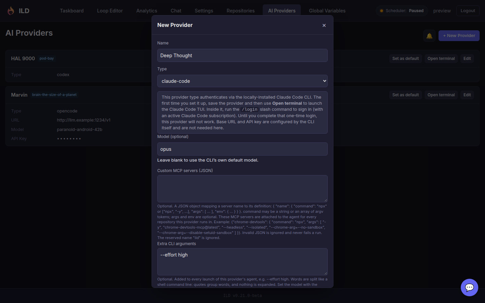

**2. Add a repository** — **Repositories** groups repositories under the remote provider that hosts them (GitHub, Forgejo or Azure DevOps). A repository needs a name, a clone URL and a default branch; a custom `.env` is stored encrypted and handed to its previews without ever being written into the worktree.

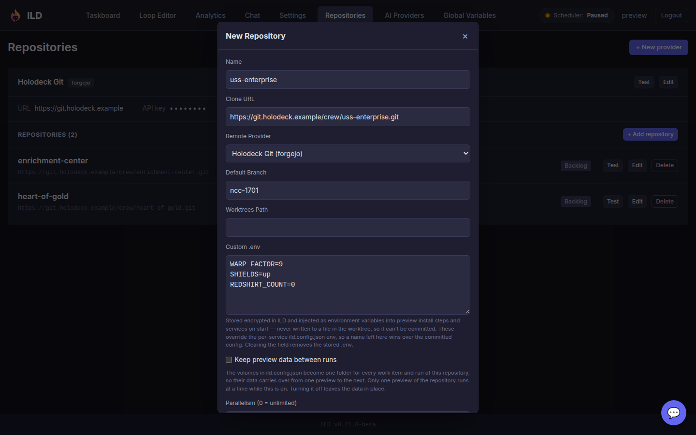

**3. Create a work item** — **New work item** on the Taskboard takes a title, a Markdown description, attachments, the repository and tags. A tag that names a loop template decides which loop runs the item. Move it to the Work queue and the scheduler starts it.

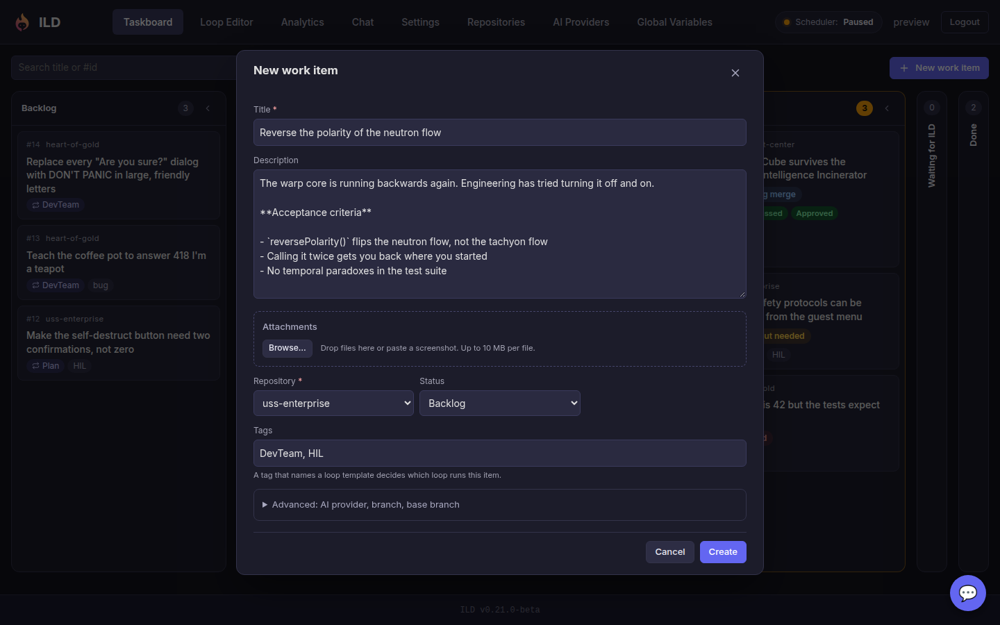

### Features

**Taskboard** — every work item, from backlog to done, in one view. Each card in the Work queue says why it waits or that it is ready to go; the order is a preference, not a line: Ild starts the top-most item that can start, and a waiting item doesn't hold up the ones below it. A running card carries the node it is on and how long it has been running; a parked one says why it stopped, down to the PR's CI and review verdicts. Tags that name a loop template are highlighted, because that is what decides which loop the item runs.

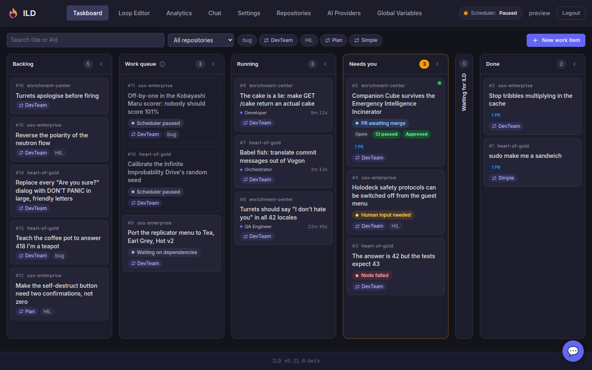

**AI chat** — a chat bubble on every page, wired to the same work-item tools the loops use. Ask it what is on the board and it reads the real one; tell it to file something and the card is there when you close the panel. It knows which work item you have open, so you can ask about that one directly — what its run is doing, why a step failed, what its branch changes.

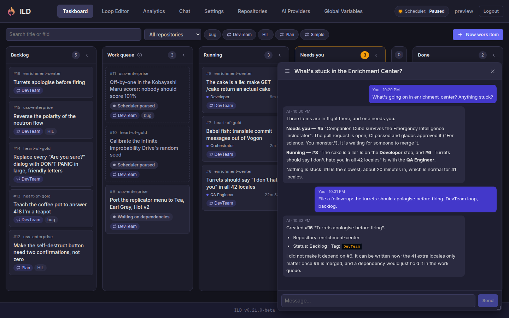

**Scheduled chats** — a chat can start itself on a timer with a prompt you set. Run a weekly retro: the agent reads the loop analytics, the paths runs took, the feedback you gave and the review comments they got, and proposes changes to loop templates and global variables for you to approve, so the loops get better at your work week by week. Or run a nightly check that files a work item for whatever it finds. On the Chat page, chats a schedule started carry a clock mark, and starred ones stay at the top.

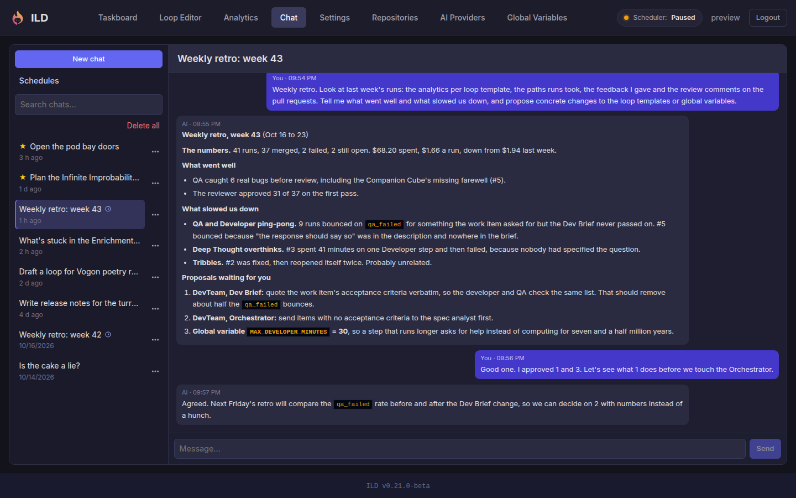

**Loop Editor** — build loop templates visually by wiring together `Start`, `Prompt`, `AI`, `PR`, `Condition`, `Human`, and `Cleanup` nodes. This is the `DevTeam` loop: an orchestrator that routes to a spec analyst, an explorer, a developer, a QA engineer and a reviewer, with named edges — `qa_failed`, `on_merge_conflict`, `ask_human` — carrying the work back to whichever role should handle it. You don't have to wire it by hand: open the AI chat on the Loop Editor and it can read the loop on the canvas and build or change it with you. It edits the canvas, and saving stays with you.

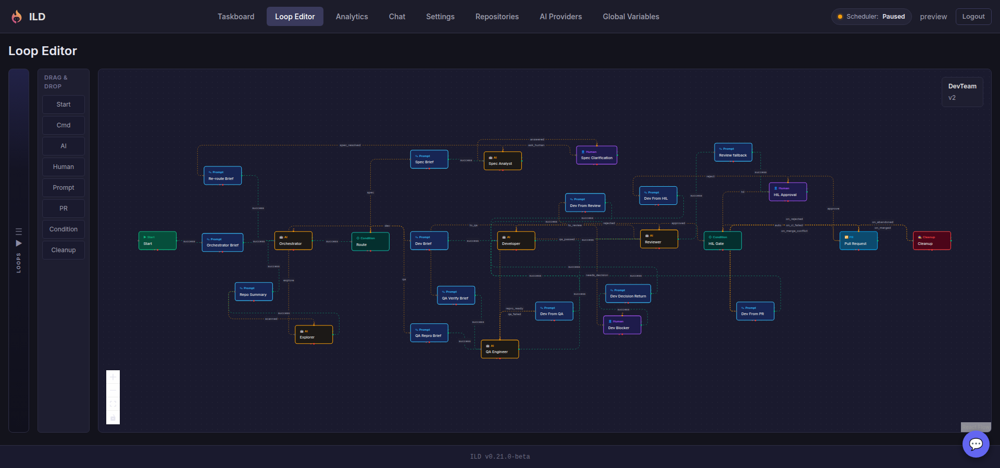

**Run timeline** — the Runs tab replays a run node by node: what each one was given, what it produced and how long it took, with what the run's AI nodes cost in dollars and tokens on top. **Retry** on a node runs the loop again from there with the same input.

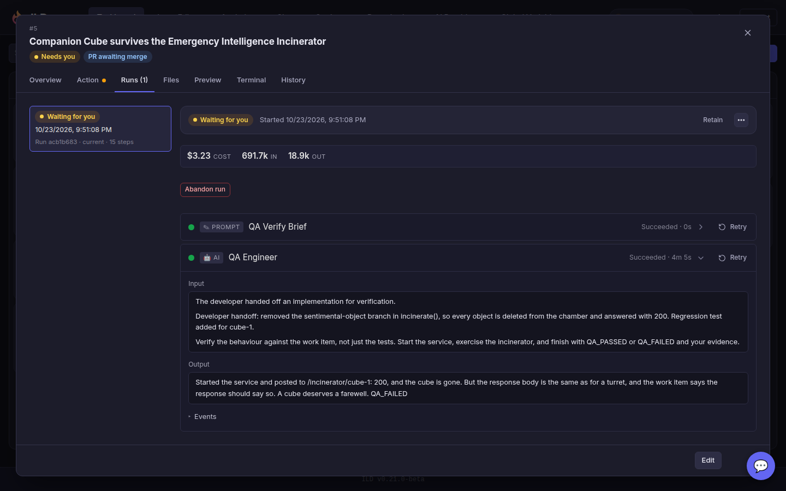

**Human gates** — when a loop reaches a `Human` or `PR` node it parks and waits. The Action tab shows why it stopped, the pull request's state and review thread, and one button per way out of the node — here **Approve**, **Merge** and **Reject**.

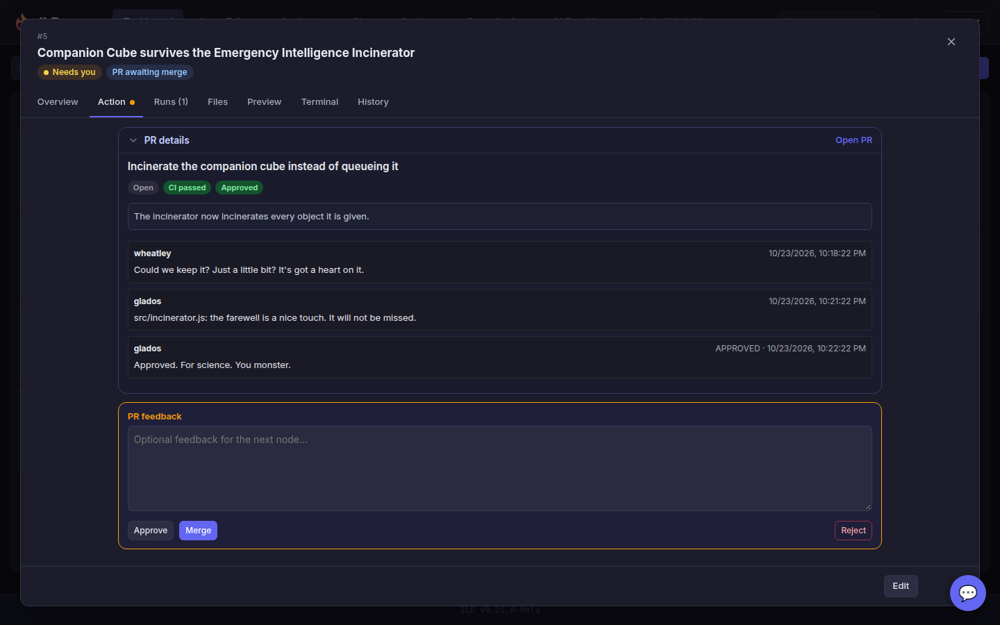

**AutoMerge** — not every change needs you at the end. Tag a work item `AutoMerge` and its pull request merges itself once every check is green: through the forge's own auto-merge where it has one, and by Ild where it doesn't. If the merge can't go through, the item asks you to merge it by hand. Remove the tag before then and nothing merges.

**Files diff** — the Files tab shows the exact git diff produced by the AI agent inside its isolated worktree, so you can review every addition and deletion before the branch is pushed or a PR is opened.

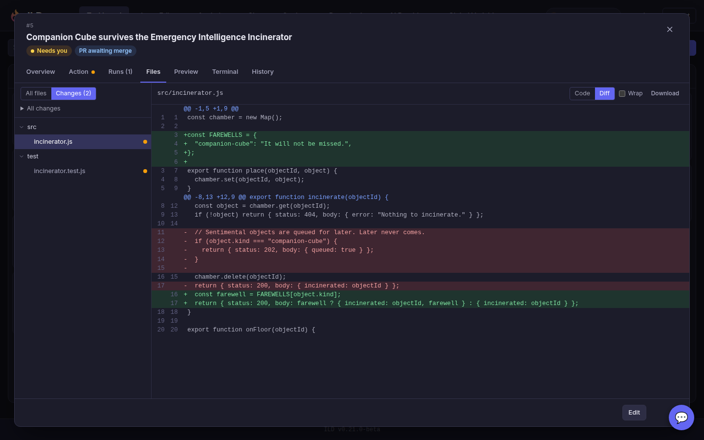

**QA preview** — the Preview tab boots the project's own services inside the run's worktree, on ports allocated for that run, and gives you a link to open and test the AI's changes live before they are merged. Which services, and how they start, comes from [`ild.config.json`](docs/configuration.md#ildconfigjson) in the repository root.

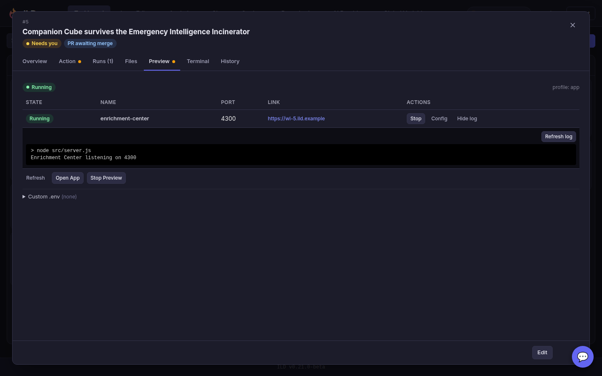

**Network** — agents reach the outside world through one proxy, and every attempt is on the record: an allow/block list, a live log of what was tried and what happened to it, and an **Allow** button on any blocked row. Forwards relay a named destination on loopback for the clients that cannot be pointed at a proxy — databases, caches, mail.

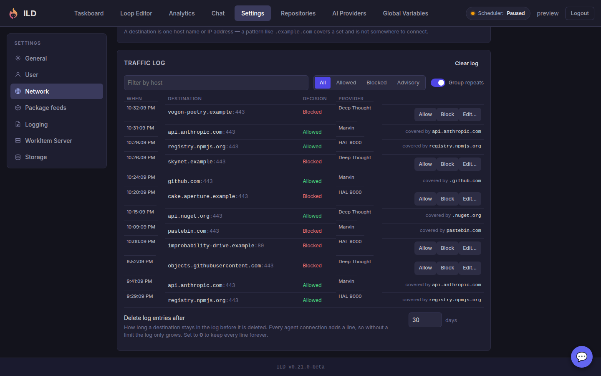

**Run analytics** — what the loops and chats actually cost. Totals and per-day spend, broken down by agent provider, by loop template and by chat, so an expensive template is visible before the bill is.

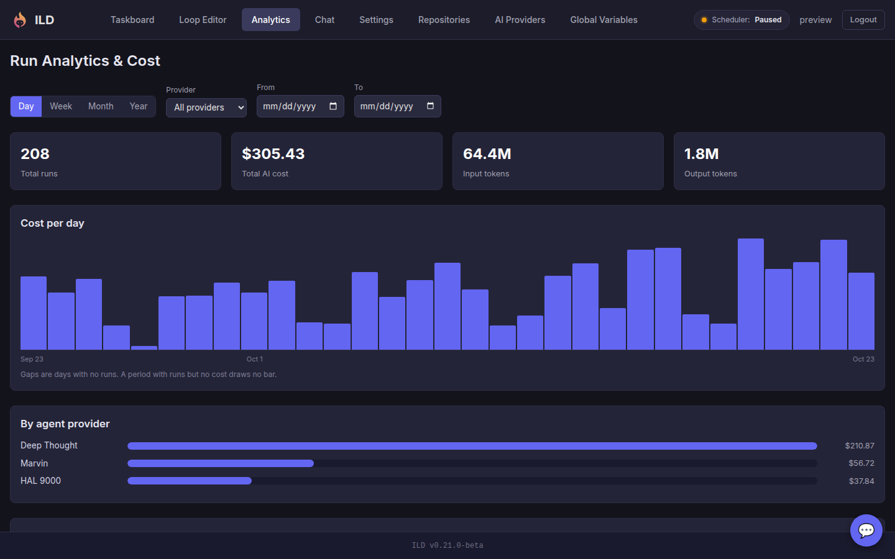

**On your phone** — on a small screen the board shows one column at a time behind a row of status tabs, with a tab bar along the bottom. A work item's Action tab keeps the review thread and the answer buttons within reach, so a pull request can be merged from the sofa, and chats open full screen.

<p>
  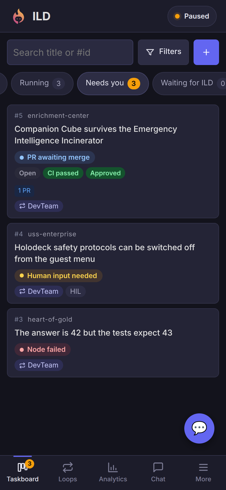
  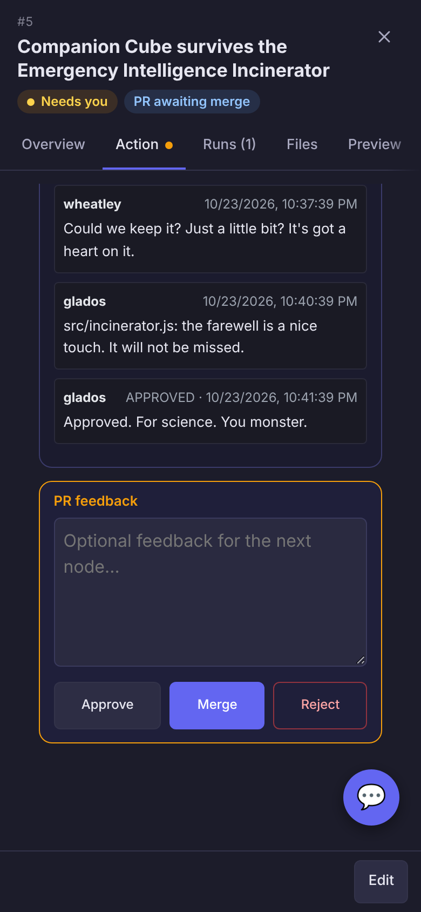
  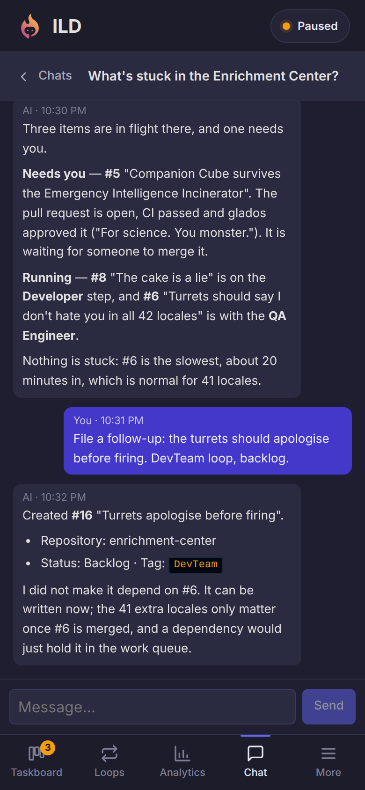
</p>

## Documentation

| Doc                                        | Contents                                                    |
| ------------------------------------------ | ----------------------------------------------------------- |
| [Architecture](docs/architecture.md)       | Service split, module boundaries, realtime channel          |
| [Domain model](docs/domain-model.md)       | Core concepts, node types, and the AI execution model       |
| [Configuration](docs/configuration.md)     | Environment variables and build-time container options      |
| [API surface](docs/api.md)                 | ILD and WorkItem Server endpoints, SignalR hubs, versioning |
| [Deployment](docs/deployment.md)           | Compose stack, volumes, images, first-startup behavior      |
| [Development](docs/development.md)         | Running from source, validation, migrations, QA preview     |
| [Troubleshooting](docs/troubleshooting.md) | Common operational issues                                   |
| [CONTEXT.md](CONTEXT.md)                   | Deep engineering reference and domain glossary              |
| [PRD.md](docs/PRD.md)                      | Product requirements and scope                              |

## License

See [LICENSE](LICENSE).
